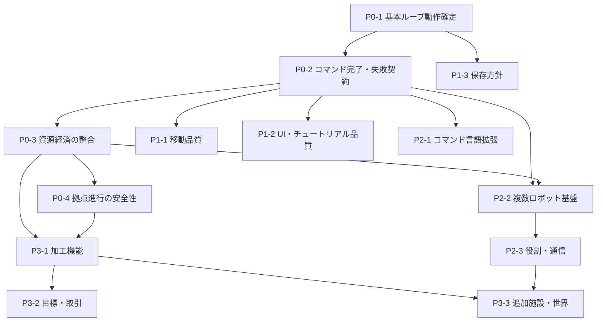

# AlgomateColony 将来構想と開発ロードマップ（提案）

## 1. この資料の位置づけ

本書の機能案は、既存README、`Assets/Docs/story.md`、`AlgorithmColony_Memo.md` に記載された将来アイデアと、現行実装上の依存関係を整理したものです。**確定仕様、実装済み機能、時期を約束する計画ではありません。**

- 既存資料が直接示す内容は「既存資料の構想」と記します。
- 体験上の狙い・実装順は「提案」と記し、開発者の意図と混同しません。
- 各フェーズの完了条件は提案した検証可能な条件です。採用前に開発者の確認が必要です。

現状と未実装範囲は [ImplementationStatus.md](./ImplementationStatus.md)、現行ルールは [GameSpecification.md](./GameSpecification.md) を参照してください。

## 2. 将来構想の候補

### 2.1 コマンド言語の拡張

- **既存資料の構想**：`if`／`else`、`for`／`while`、関数／呼び出し、`broadcast`／`listen`、条件達成による命令の解放。
- **提案する体験上の狙い**：単発命令から繰り返し可能な作業手順・条件付き自動化へ段階的に発展させる。
- **既存実装との関係**：現行はUIが各行を `CommandHandler` で検査し、`RobotCommandExecute` が文字列を別途判定する。一般的な構文木・インタープリタは確認できない。未登録の `Loop();` 用分岐はあるが、利用可能なループ機能ではない。
- **主な課題**：明確な文法、型・対象名の検証、エラー位置と説明、実行停止・キャンセル、無限ループや命令数制限、コマンド完了待ちのタイムアウト、チュートリアルとの互換性。
- **段階提案**：まず既存3コマンドの検証と実行が同一の定義に基づき、成功・失敗を必ず返せる状態にする。その後、反復、条件分岐、関数、複数体通信の順に一段ずつ検討する。

### 2.2 複数アルゴメイトと役割分担

- **既存資料の構想**：ロボット同士の協力、採集・運搬・製造等の専門化、通信命令。
- **提案する体験上の狙い**：作業を複数体に分け、単体への逐次指示からコロニー単位の運用へ広げる。
- **既存実装との関係**：`RobotFactory` にはPrefab追加生成の経路がある一方、通常起動は初期生成1回。複数体のコマンド選択・同時実行・共有タスク割当が完成している証拠はない。
- **主な課題**：ロボット識別と選択状態、タスク所有権、倉庫への競合格納、対象資源の重複予約、UI・チュートリアルの複数体対応、性能・優先順位。
- **前提案**：先に単体の失敗通知・キャンセル・在庫更新を安定させる。次に2体で異なる命令を同時実行し、同一対象／倉庫の競合をテストできる基盤を用意する。

### 2.3 コロニーの発展・生産

- **既存資料の構想**：拠点レベルに応じた新機能、加工・研究・自動化施設、充電・修理、植林・採掘、リサイクル、センサー、輸送、防衛・環境管理。
- **提案する体験上の狙い**：収集から保管、加工、利用へと資源ループを広げ、拠点成長を選択と運用につなぐ。
- **既存実装との関係**：在庫、加工品データベース、加工UI、レベルアップ解放データは一部ある。レベル0の次に加工室Prefabを生成するデータがあるが、加工ボタンから製品を作る処理は確認できない。
- **主な課題**：レシピと入出力データ、施設の配置・稼働状態、必要素材の原子的消費、在庫の永続性、レベル上限、拠点UI表示とデータの整合。
- **順序提案**：先にロボット所持品→倉庫→レベルアップの数量整合を固める。次に単一レシピの加工を完結させ、後から複数レシピ・施設段階・自動化を追加する。

### 2.4 他コロニー、交易、クエスト

- **既存資料の構想**：他コロニーを協力者または競争相手として扱い、資源共有や取引を行う。加工品出荷、収益による素材購入、シナリオ目標・報酬型クエストの案がある。
- **提案する体験上の狙い**：生産と倉庫管理に外部需要・長期目標を加える。
- **既存実装との関係**：現在の倉庫在庫・加工UIは基礎接点になり得るが、通貨、相手コロニー、契約、報酬、クエスト進行の実装は確認できない。
- **主な課題**：価格・数量ルール、受注・納品の状態遷移、報酬の重複受取防止、ゲーム進行との同期、相手の振る舞い・物語の定義。
- **順序提案**：まずローカルな納品目標と報酬を実装・検証し、その後、交易相手の在庫・価格・関係性を検討する。競争・協力のどちらを中核にするかは開発者への確認事項。

### 2.5 敵対する住民・脅威

- **既存資料で確認できるもの**：Memoは野生動物・自然災害などの脅威と防衛施設を構想として記載しています。Storyは戦闘中心ではなく運営で発展するトーンを記載しています。
- **未確認のもの**：敵対する「住民」や固有の敵勢力は、調査した既存資料から具体的な仕様を確認できません。
- **提案**：敵対要素を追加するかは未決定として扱います。採用する場合は、戦闘を主軸にするか、資源・物流・施設への脅威として扱うか、Storyの非戦闘中心という方向と整合するかを先に決めます。
- **必要になる可能性のあるシステム**：脅威の出現条件、対象選択・攻撃／回避、防衛設備、耐久・修理、被害復旧、難易度・報酬、チュートリアル。
- **開発者への確認**：住民・敵勢力を構想に含めるか、野生動物や環境脅威と区別するか。

### 2.6 世界観・長期目標の拡張

- **既存資料の構想**：荒廃した惑星、稼働限界に近いロボットの再起動、失われた文明の技術、研究による自動化の発展という背景は `Assets/Docs/story.md` に記載されています。他コロニーとの関係性や長期目標も拡張方向として挙げられています。
- **提案する体験上の狙い**：既存の資源収集・運搬ループを研究や長期目標に接続し、拠点成長の方向性を選ぶ構造を検討できます。これは提案であり、確定したゲーム設計ではありません。
- **既存実装との関係**：チュートリアル、拠点レベル、レベル解放データはありますが、失われた技術の収集、研究進捗、シナリオ分岐、長期クエストを確認できません。
- **主な課題**：ストーリーの提示方法、シナリオと資源経済の接続、目標達成の永続化、探索・研究のプレイ上の選択、運営中心の世界観と脅威・戦闘要素との整合。
- **開発者への確認**：Story内の惑星・文明・研究設定を現行プロトタイプの正式な世界設定として扱うか、ポートフォリオでどこまで公開するか。

## 3. 推奨ロードマップ

優先順は、依頼に従い **基本ループの完成 → 既存機能の品質向上 → 遊びの拡張 → 追加コンテンツ** とします。ここに示すのは文書上の提案で、実装を行ったものではありません。

| 順位・段階 | タスク／目的 | 前提条件 | 成果物（提案） | 完了条件（提案） |
|---|---|---|---|---|
| **P0-1 現状ループの動作確定** | Move→Gather→Deposit→拠点レベルアップ→加工室Prefab出現を、意図した最小ゲームループとして確定する。 | 開発者が現在のプレイ目標と成功条件を確認する。 | Unity Editor／配布候補ビルドの再現手順、動作・未動作記録。 | 新規状態からチュートリアル経由でレベルアップ・施設出現まで通し確認し、失敗時も再現条件が記録される。 |
| **P0-2 コマンド完了・失敗契約** | 検証、実行、完了通知の食い違いを洗い出し、行動が成功・失敗・中断のいずれで終わるか明示できるようにする。 | P0-1で基本フローと代表的失敗入力が決まっている。 | コマンド文法表、入力エラーと実行結果の仕様、回帰テスト項目。 | 有効／無効入力、対象なし、倉庫なし、所持不足、満杯、資源消失の各ケースが停止せず結果を返すことを確認できる。 |
| **P0-3 資源経済の整合** | 採集、所持Slot、倉庫加算、素材消費、表示値の一致を保証する。 | P0-2で行動の成功・失敗結果が識別できる。 | 在庫更新ルール、容量・数量仕様、素材移動のテストシナリオ。 | 追加・消費後のロボット在庫、倉庫在庫、レベルアップ表示が一致し、失敗時に数量が部分更新されないことを確認できる。 |
| **P0-4 拠点進行の安全性** | レベルアップ素材の不足、上限、再押下を安全に処理する。 | P0-3で素材移動・消費結果を確認できる。 | 最大レベル・必要素材・Prefab解放表、境界テスト。 | 素材が不足する場合に消費・レベル加算・施設生成が起きず、上限時に例外なく適切なUI状態となる。 |
| **P1-1 移動品質の定義** | 直線ウェイポイント＋局所回避で必要品質を満たすか判断し、移動失敗条件を明示する。 | 基本ループの対象・マップ・障害物シナリオが定義済み。 | 移動仕様、障害物テスト場面、失敗／再探索ルール。 | 開放空間、障害物、移動対象消失、エネルギー切れの結果を定義・検証。高度な経路探索は必要性が確認されてから別タスクとする。 |
| **P1-2 UI・チュートリアル品質** | 操作エラー、状態、進行条件を読者・プレイヤーに説明し、データ不正時の停止を防ぐ。 | P0の操作と失敗契約が確定している。 | チュートリアル遷移表、UI文言、アニメーション／SO参照チェックリスト。 | 全チュートリアル段階が完了し、必要フラグ・Scene参照が検証され、異常状態の表示／再試行方針が定義される。 |
| **P1-3 保存・再開方針の決定** | セーブが必要か決定し、必要なら在庫・進行・ロボットの永続化を設計する。 | ゲームのプレイ時間・配布形態が決まっている。 | セーブ対象・バージョン互換・リセット挙動の仕様。 | 保存対象と対象外が文書化され、必要と決定した場合は再起動をまたぐ保存・読込テストが通る。 |
| **P2-1 コマンド言語の小規模拡張** | 現行3命令を安定させた後、繰り返し等の最初の制御構造を選定する。 | P0-2で文法・実行結果・停止条件が確定。 | 選定構文の文法、エラー仕様、実行制御、テスト。 | 構文有効／無効、終了条件、キャンセル、異常停止を自動テストまたは再現手順で確認。 |
| **P2-2 複数ロボットの基盤** | 複数体を識別し、それぞれに命令・状態を割り当てられるようにする。 | 単体ループが安定し、同時実行時の在庫・対象競合ルールが定義済み。 | 選択・タスク割当・競合管理の仕様と2体以上の試作検証。 | 2体以上を選択して別命令を実行し、対象競合・倉庫更新・UI切替が仕様通りに動く。 |
| **P2-3 役割・通信** | 役割分担や `broadcast`／`listen` が実際に必要か評価し、採用時はタスク共有を設計する。 | P2-2の複数体基盤と開発者の協調方針決定。 | 役割データ、通信メッセージ、再試行・競合ルール。 | 単純な採集・運搬分担が目標達成し、通信不能／重複受信等の扱いが検証される。 |
| **P3-1 加工機能の縦切り** | UI表示にとどまる加工を、単一レシピの素材消費から製品生成まで完結させる。 | P0-3の在庫整合、施設利用可能条件、レシピ定義が確定。 | 1レシピの入力・実行・結果UIと素材消費テスト。 | 必要素材がある場合だけ一度消費・生成され、不足時や連打時の重複生産が起きない。 |
| **P3-2 目標／クエストと取引** | 追加の長期目標が必要と判断した場合、まずローカル納品目標を検証する。 | 生産・倉庫・報酬の数量整合が確認済み。 | 目標データ、進行判定、報酬、UI。 | 条件達成・未達成・再受注・報酬受取の状態が重複せず検証できる。外部コロニー取引はその後に判断する。 |
| **P3-3 追加施設・世界コンテンツ** | 研究、充電、修理、リサイクル、防衛、環境管理、地形等の案を、選定した中核ループに沿って追加する。 | コアゲームループ、コロニー進行の方向、必要コンテンツ量が合意済み。 | 選定施設の仕様、データ、UI、チュートリアル、コンテンツ。 | 各追加施設が既存データ・資源ループと接続し、実装済み範囲が本資料群で更新されている。 |

## 4. 依存関係の要約

この順序は実装を約束するものではありません。開発者が「プログラミング言語の学習」「複数ロボット協調」「生産経済」「世界・物語」のどれを主軸にするか決めたうえで、P2以降の範囲を調整してください。

## 5. 開発者への確認事項

1. 最初の完成ループを加工施設の解放で終えるのか、加工品の実生産まで含めるのか。
2. プレイヤー向けコマンドを自由記述のままにするのか、補完・選択式・ブロック等を併用するのか。
3. `if`／ループ／関数のどれを優先するか、学習目的・想定ユーザーは何か。
4. 複数ロボットの協調が必須の設計目標か、単体操作を先に磨くか。
5. 他コロニーは協力・交易・競争のどれを中心にするか。敵対住民は構想に含めるか。
6. 作品全体の白黒ビジュアルを意図しているか。正式なスクリーンショットや画面設計資料はあるか。
7. セーブ、ゲームクリア条件、対象プラットフォーム、プレイ時間の目標。

## 6. 既存の構想資料

- [AlgorithmColony_Memo.md](../AlgorithmColony_Memo.md)：施設、複数ロボット、コマンド、経済等のアイデア。
- [Assets/Docs/story.md](../Assets/Docs/story.md)：世界観、体験の軸、拡張方向。
- [README.md](../README.md)：現在の紹介と今後予定（実装範囲はコードとの再照合が必要）。
- [GameSpecification.md](./GameSpecification.md)：コード照合済みの現行ルール。
- [ImplementationStatus.md](./ImplementationStatus.md)：機能成熟度と根拠。
- [LogicFlows.md](./LogicFlows.md)：処理呼び出し・データ変化の詳細。
