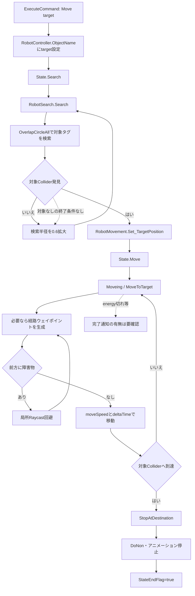
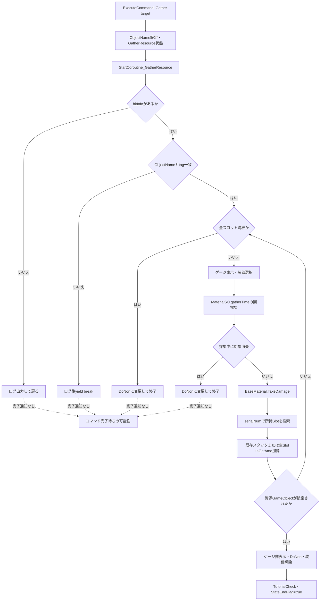
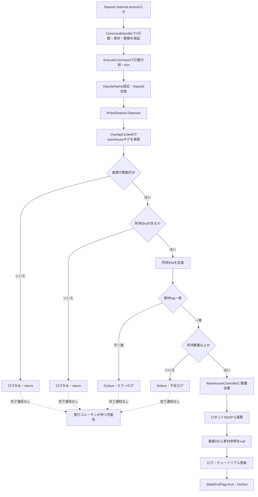
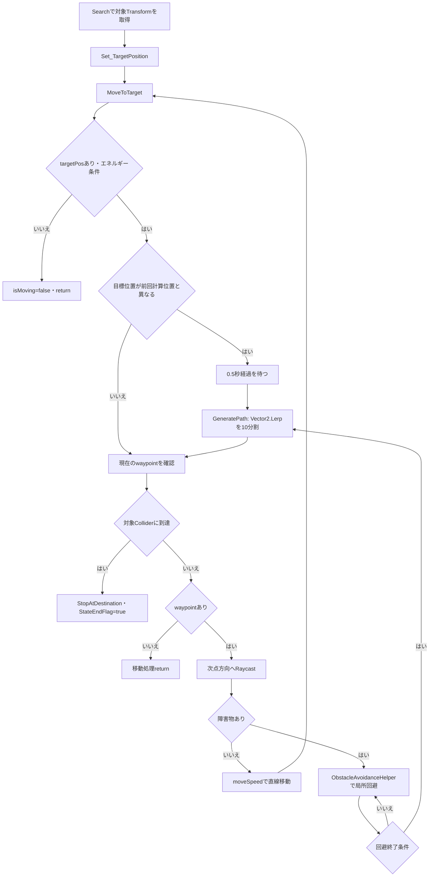
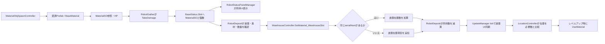
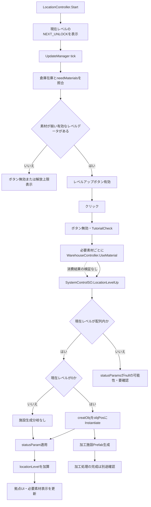
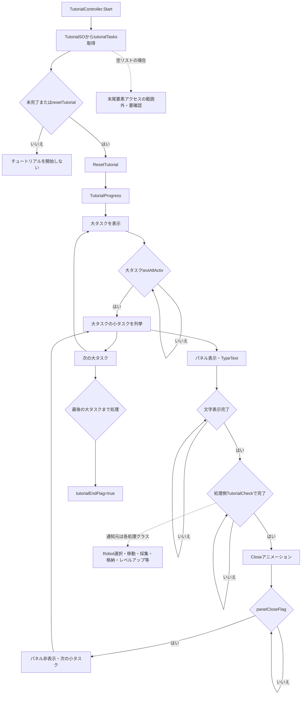

# AlgomateColony 主要ロジックフロー

この資料は、リポジトリ内で確認できるコードとシリアライズ済みアセットから、主要な処理を入力から結果まで追跡したものです。Unity Editor上での通しプレイ検証は行っていません。

## 表記と対象範囲

- **確認済み**：ソースコードまたはアセットの内容から直接確認できること。
- **要確認**：Unity Inspector上の参照・実行時挙動・設計意図を、このリポジトリ調査だけでは断定できないこと。
- 図中の `要確認` は、処理や成功を推測で補っていない箇所です。
- `Assets/Scenes/GameScene.unity` が `ProjectSettings/EditorBuildSettings.asset` で有効なビルド対象Sceneです。Scene上の全Inspector参照の実行確認は未実施です。

## 1. コマンド入力から実行まで

### 開始条件・入力

- プレイヤーがロボットを選択すると、`RobotStatusPanelManager.SetRobotStatus(RobotController)` がロボットの `RobotCommandExecute` を取得し、`RobotCommandUIController.SetRobot(...)` に渡します。
- プレイヤーはロボット状態パネルのコーディング入力欄に、1行につき1コマンドを入力します。
- 入力検証は `CommandLoader.Start()` が `Resources/MoveCommands.json`、`GatherCommands.json`、`DepositCommands.json` を読み込んだ後に利用する前提です。ファイル欠落時の処理は実装されていません。

### 呼び出し順・データ変化

1. `RobotCommandUIController.CommandCheckButtonOnClick()` がロボット側の `ProcText` を `null` にし、`StateEndFlag` を `false` にします。
2. `CheckTextCommand()` が入力を `\n` と `\r` で分割し、空行を除去します。チュートリアル用に最初の行が厳密に `Move(location);` かを確認します。
3. `InputCommand()` が各行について `CommandHandler.CheckCommand()` を呼びます。全行が検証成功した場合だけ、入力をロボットの `RobotCommandExecute.ProcText` に保存し、実行ボタンを有効化します。
4. 実行ボタンから `StartCoroutine_CommandToExecution()` が呼ばれ、ロボットに紐づいた `RobotCommandExecute.CommandToExecution()` が行を順番に処理します。
5. 各コマンドは `RobotController.ChangeState(...)` を呼び、該当状態の処理が `StateEndFlag = true` にするのを `WaitUntil` で待ちます。
6. 最終行が `Loop();` と一致した場合は `commandIndex = 0` に戻す分岐があります。それ以外の最終行は `DoNon` に戻してコルーチンを終了します。

### 成功・失敗・UI

- **検証成功**：入力行が `ProcText` に設定され、チェック表示が「成功」（緑）になり実行ボタンが有効化されます。これは入力形式の検証成功であり、ゲーム内処理の成功を保証しません。
- **検証失敗**：チェック表示が「失敗」（赤）になり、実行ボタンが無効化されます。コマンドの詳細なエラー位置・理由をUIに表示する処理は確認できず、無効行の `Debug.Log` が出力されます。
- **実行開始**：`RobotCommandUIController.ExecuteButtonOnClick()` はコルーチンを開始した後、`RobotStatusPanelManager.BackButtonOnClick()` で状態パネルを閉じます。実行完了までの状態はロボット側コンポーネントが保持します。
- **実行中の失敗・例外**：`CommandToExecution()` は状態完了フラグを待ちます。下記各フローに示すように、エラー経路で完了フラグが立たない場合は後続コマンドに進みません。コマンドごとのタイムアウト／キャンセル処理は確認できません。

### 文法・設計上の注意

- 検証対象は `Move`、`Gather`、`Deposit` の3種類です。`cmd:location` と `cmd:setting` は `InputCommand` とは別の補助入力です。
- `Move` と `Gather` の引数はJSON内の `command` と一致するか検証されます。現行JSONではMove対象に `location`、`warehouse`、`rock`、`tree`、`ironOre`、Gather対象に資源3種が登録されています。
- `Deposit` はJSONにある素材名と `int.TryParse()` できる数量の2引数を確認します。数量の正値・上限チェックはありません。
- `CommandHandler.CheckCommand()` は `StartsWith()` と括弧内抽出を使い、文全体の厳密な文法や末尾セミコロンを検証しません。一方、`RobotCommandExecute.ExecuteCommand()` はコマンド文字列全体が `Move(arg);` 等と一致する場合だけ状態遷移します。検証を通ったが実行分岐に一致しない行は状態を変えず、完了待ちになります。
- `Loop();` は検証用マップにも `ExecuteCommand()` の実行分岐にもないため、現在の入力経由で使えるコマンドとしては確認できません。実行コルーチンに残った特殊分岐と、既存技術資料の「Loop対応」は区別してください。
- `CommandLoader.Load()` は `Resources.Load<TextAsset>()` の戻り値やJSON解析結果を検査していません。ファイル不足等の場合の明示的な回復処理はありません。

### 関連アセット

- Scene：`Assets/Scenes/GameScene.unity`
- ロボットPrefab：`Assets/Prefab/Robot/Robot_0_Root.prefab`
- UIの入力・選択クラス：`Assets/Scripts/Robot/RobotCommandUIController.cs`、`Assets/Scripts/Manager&Controller/RobotStatusPanelManager.cs`
- 定義データ：`Assets/Resources/MoveCommands.json`、`Assets/Resources/GatherCommands.json`、`Assets/Resources/DepositCommands.json`

```mermaid
flowchart TD
    A[ロボットを選択] --> B[RobotStatusPanelManager.SetRobotStatus]
    B --> C[RobotCommandUIController.SetRobot]
    C --> D[入力欄を改行分割]
    D --> E[各行をCommandHandler.CheckCommandで検証]
    E --> F{全行有効か}
    F -- いいえ --> G[失敗表示・実行ボタン無効]
    F -- はい --> H[ProcTextに保存・成功表示]
    H --> I[実行ボタン]
    I --> J[StartCoroutine_CommandToExecution]
    J --> K[先頭コマンドをExecuteCommand]
    K --> L{Move / Gather / Depositの完全一致}
    L -- はい --> M[RobotController.ChangeState]
    M --> N[各状態の処理]
    N --> O{StateEndFlagがtrueか}
    O -- いいえ --> P[WaitUntilで待機]
    P --> O
    O -- はい --> Q{最終行か}
    Q -- いいえ --> R[次の行へ]
    R --> K
    Q -- はい --> S{最終行がLoop();か}
    S -- はい --> T[先頭へ戻す分岐]
    T --> K
    S -- いいえ --> U[DoNonに戻して終了]
    L -- いいえ --> V[状態遷移なし・StateEndFlag=falseのまま待機]
    V --> P
    S -. Loopは検証・実行対象外のため通常入力では到達しない .-> W[コード上に残る分岐]
```

## 2. `Move(target);` 相当の移動処理

### 開始条件・入力

- `Move(target);` がコマンド検証を通り、ロボットの `ProcText` に設定され、実行コルーチンが当該行に到達すること。
- `target` は `MoveCommands.json` のコマンド文字列と一致し、対象SceneオブジェクトのタグおよびCollider設定も検索・到達判定に適合する必要があります。

### 呼び出し順・データ変化

1. `RobotCommandExecute.ExecuteCommand()` が `robotCont.ObjectName = target` を設定し、状態を `RobotController.State.Search` にします。
2. `RobotController.Update()` の `Search` 分岐から `RobotSearch.Search(objectName)` を呼びます。
3. 対象が見つかると `RobotSearch` が `RobotMovement.Set_TargetPosition(hit.transform, true)` を呼び、`RobotController` の状態を `Move` にします。
4. `RobotController.Update()` の `Move` 分岐から `RobotMovement.Moveing()`、`MoveToTarget()` が毎フレーム実行されます。
5. 到達判定が成立すると `StopAtDestination()` が `DoNon` に戻し、移動アニメーションを止め、`RobotCommandExecute.StateEndFlag` を `true` にします。対象タグが `location` の場合、チュートリアルにも通知します。

### 成功・失敗・UI

- **成功**：対象のColliderに到達判定できればロボットは停止し、コマンド列が次へ進みます。移動開始時・待機時のログが `LogController` に渡されます。
- **対象が見つからない**：`RobotSearch` は検索半径を0.6ずつ拡大しますが、探索上限・失敗状態・完了通知がありません。対象が永久に見つからなければ `Search` を続ける可能性があります。
- **エネルギー切れ／対象未設定**：`RobotMovement.MoveToTarget()` は移動フラグを下げて戻りますが、そのメソッド内では状態完了通知を行いません。電池処理による状態変更・復帰を含む最終挙動は `RobotBattery` 側との実行確認が必要です。
- **対象破棄・障害物等**：対象参照が消失した場合、到達判定に成功せず停止・完了通知されない可能性があります。停止条件の網羅的な回復処理は確認できません。
- **UI**：`RobotMovement` がRunアニメーションと左右反転を更新し、`RobotController` がエネルギー／採集スライダーの位置を追従させます。移動経路の表示UIはなく、ウェイポイントはEditorのGizmosで表示されます。

### 関連アセット・注意点

- Scene：`Assets/Scenes/GameScene.unity`
- ロボットPrefab：`Assets/Prefab/Robot/Robot_0_Root.prefab`
- 移動先の対象例：`Assets/Prefab/MaterialObj/Rock.prefab`、`Tree.prefab`、`IronOre.prefab`、Scene上の拠点・倉庫。Prefab上のタグ例としてRockは `rock` です。
- データ定義：`Assets/Resources/MoveCommands.json`
- 対象発見と移動到達のLayerMask／タグ／ColliderはコンポーネントのInspector設定に依存します。対象オブジェクトごとの全設定値は要確認です。



## 3. `Gather(target);` 相当の採集処理

### 開始条件・入力

- 通常は同一コマンド列内の先行 `Move(target);` が対象を検索し、`RobotController.hitInfo` にColliderを保持している状態で `Gather(target);` を実行します。
- `target` は対象のタグと一致することを前提とします。素材の採集時間・耐久・装備種別は `MaterialSO` にあります。

### 呼び出し順・データ変化

1. `RobotCommandExecute.ExecuteCommand()` が `ObjectName` を設定し `GatherResource` 状態にします。
2. `RobotController.Update()` の状態開始時に `RobotGather.StartCoroutine_GatherResource()` を呼びます。
3. `RobotGather.GatherResource()` が対象Colliderの存在とタグを確認し、資源が有効なら採集ゲージを表示します。
4. `MaterialSO.gatherTime` を基準に、装備を選び、`UpGread_GatharRate()` が収集速度を設定します。時間経過後、`BaseMaterial.TakeDamage(gatherStrength)` を呼びます。
5. 資源の `serialNum` と所持スロットを比較し、既存スタックまたは空きスロットに `MaterialSO` と `GetAmo()` を加算します。
6. 対象GameObjectが破棄され、次の反復で `GetHitInfo()` がnullと判定された経路では、採集UIを隠し、待機状態に戻し、装備表示を外し、チュートリアル通知とコマンド完了通知を行います。

### 成功・失敗・UI

- **成功**：対象の耐久が尽きて破棄されるまで採集反復し、得た数量を `BaseStatus.Slot[]` に加えます。現在 `amo` は `BaseMaterial` 内で1です。所持スロットは5枠、各Slotの `ITEM_STACK_MAX` は100です。
- **対象なし**：`StartCoroutine_GatherResource()` はログを出して戻るだけで、状態変更・コマンド完了通知を行いません。
- **タグ不一致**：コルーチンはログ後に `yield break` しますが、状態／完了フラグの更新はありません。
- **インベントリ満杯**：待機状態へ変更してコルーチンを抜けますが、`StateEndFlag` は立てません。
- **採集中に資源消失**：待機状態へ変更してコルーチンを抜けますが、採集ゲージ非表示・装備解除・コマンド完了通知はその分岐では行われません。
- **エネルギー処理による中断**：採集ループ条件が `recharge_battery == false` のため、充電フラグによってループを抜ける場合があります。抜けた後にコマンド完了通知する処理は確認できません。
- **数量に関する注意**：致死ダメージ時、`BaseMaterial.TakeDamage()` は `deathFlag = true` の後にメソッド末尾で `deathFlag = false` に戻します。続く `GetAmo()` はfalse側の値を返すため、コード上は致死採集でも `amo + 10` の分岐が使われません。
- **UI**：採集中はGather Sliderとログが更新されます。ロボット状態パネルの所持枠表示は `RobotStatusPanelManager` が `BaseStatus.Slot[]` を参照して更新します。

### 関連アセット・注意点

- Scene：`Assets/Scenes/GameScene.unity`
- ロボットPrefab：`Assets/Prefab/Robot/Robot_0_Root.prefab`
- 資源Prefab：`Assets/Prefab/MaterialObj/Rock.prefab`、`Tree.prefab`、`IronOre.prefab`。Rock prefabは `rock` タグとCollider2Dを持ちます。
- 資源定義：`Assets/ScriptableObject/Material/` 以下の `MaterialSO` 資産
- 採集コマンド定義：`Assets/Resources/GatherCommands.json`
- スロット加算処理は所持数100の上限を超えないように分割・拒否する処理を、確認した `RobotGather` 内で保証していません。境界値での挙動は要確認です。



## 4. `Deposit(target, amount);` 相当の格納処理

### 実装上の引数

- `Deposit` の第1引数は倉庫targetではなく、格納する素材の `MaterialSO.tagName`（例：`rock`）です。
- 第2引数は数量です。倉庫は引数で選択せず、ロボットの周囲を `RobotDeposit` が検索します。利用例は `Move(warehouse);` の後に `Deposit(rock, 30);` です。

### 呼び出し順・データ変化

1. `CommandHandler.DepositFunc()` がカンマ区切りの引数2つ、JSON上の素材名、整数への変換可否を検証します。
2. 実行時に `RobotCommandExecute` が引数を分割し、前後空白を除去して `RobotController.DepsiteName` に保存し、`Deposit` 状態にします。
3. `RobotController.Update()` の状態開始時に `RobotDeposit.Deposite()` を呼びます。
4. `Physics2D.OverlapCircleAll()` で `warehouse` タグのColliderがあるか調べます。
5. 所持Slotから素材タグが一致するものを探し、`itemStackAmount >= quantity` の場合に `WarehouseController.SetMaterial_WarehouseSlot()` で倉庫在庫を加算し、ロボットの数量を減らします。
6. 数量が0になったSlotは `mateSO = null` にします。成功時はログ、チュートリアル更新、`StateEndFlag = true`、`DoNon` への遷移を行います。

### 成功・失敗・UI

- **成功**：倉庫データ `WarehouseController` の在庫リストが増加し、ロボット所持数が減ります。倉庫の既存素材と `serialNum` が同じなら加算、なければ新しい倉庫スロットデータを追加します。
- **倉庫が範囲内にない**：ログを出して戻ります。状態も完了フラグも更新されないため、コマンド列が待機し続ける可能性があります。
- **所持品配列がnull／空**：ログを出して戻り、状態・完了フラグは更新されません。
- **指定数量が所持数を超える**：ログを出し `DoNon` に変更しますが、`StateEndFlag` は立てません。
- **素材不一致**：最初に見つけた非空Slotが対象素材でない場合、`else` で不一致ログを出して `DoNon` にし、Slot検索を終了します。そのため、後続Slotに一致素材があっても処理しない可能性があります。完了フラグも立ちません。
- **一致Slotが見つからない**：全Slotが空の場合はcontinueして終了し、状態・完了フラグの更新がありません。
- **引数異常**：入力検証を通る通常経路では引数は2つですが、検証と実行は別処理です。`Deposite()` 内では `DepsiteName[0]`／`[1]` を直接参照するため、不正データが渡ると範囲外アクセス等の例外が発生し得ます。
- **負数・0**：`int.TryParse()` は負数・0も許容します。数量の正値検査がありません。負数は所持数比較を通過し、負の倉庫加算とロボット所持数の増加を起こし得ます。0も成功経路に入り得ます。
- **UI**：ログは `LogController` に送られ、倉庫パネル・メインCanvasの表示は `WarehouseController` が管理します。倉庫は `UpdateManager.OnUpdateTick`（1秒周期）購読中に表示同期を行います。

### 関連アセット・注意点

- Scene：`Assets/Scenes/GameScene.unity`
- ロボットPrefab：`Assets/Prefab/Robot/Robot_0_Root.prefab`
- 倉庫UI：`Assets/Prefab/UI/Slots/WarehouseSlot.prefab`、`HaveMaterialSlot.prefab`
- 倉庫Controllerの参照元は `FacilityManager.wController` です。Scene上の実際のGameObject配線はUnity Inspectorで要確認です。
- コマンド定義：`Assets/Resources/DepositCommands.json`
- 素材定義：`Assets/ScriptableObject/Material/` 以下



## 5. 経路生成と移動経路の決定

### 開始条件・入力

- `RobotSearch.Search()` が対象を見つけ、`RobotMovement.Set_TargetPosition()` を呼び、`RobotController` を `Move` 状態にした後に移動更新が始まります。
- 入力はロボットの現在位置、対象Transformの位置、`BaseStatus.moveSpeed`、`RobotMovement` の到達半径・LayerMask・Raycast距離・回避時間です。

### 呼び出し順・経路決定

1. `RobotMovement.Awake()` は `new PathfindingSystem(10)` を生成します。
2. `MoveToTarget()` が対象を保持していることとエネルギー条件を確認し、`UpdatePathIfNeeded()` を呼びます。
3. 対象位置が最後に計算した位置と異なる間、`_elapsed` を進めます。0.5秒を超えると `CalculatePath()` が `GeneratePath(currentPosition, targetPosition)` を呼びます。
4. `PathfindingSystem.GeneratePath()` は `Vector2.Lerp` で始点から終点までを10分割した点をQueueで返します。アルゴリズムは直線補間であり、障害物地図を探索して迂回路を選ぶ処理ではありません。
5. `RobotMovement` は次のウェイポイントへ向かう方向に `Physics2D.Raycast()` を実行します。障害物がある場合は `ObstacleAvoidanceHelper` に方向候補を問い合わせ、回避時間経過または周囲の障害物消失時に直線経路を再計算します。
6. 実移動は `transform.position += direction * moveSpeed * Time.deltaTime` です。NavMesh／Tilemapの経路グラフから移動経路を選択する処理はこのフローにはありません。

### 成功・失敗・UI・関連アセット

- **成功**：`Physics2D.OverlapCircle()` が到達Layer上のColliderを返し、そのTransformが対象Transformと一致すると到達扱いになります。`StopAtDestination()` が停止処理とコマンド完了通知を行います。
- **経路が空／進行不能**：`MoveToTarget()` はウェイポイントがなく到達もしていない場合に `return` します。代替経路探索・失敗完了通知は行いません。
- **障害物回避**：局所Raycast処理であり、障害物配置によっては目的地への進行を保証しません。実際のObstacleAvoidanceHelperの角度候補やLayer設定は、コンポーネント設定を含め要確認です。
- **UI**：移動アニメーションとSpriteの左右反転を更新し、Sceneビュー等のGizmosには到達半径・ウェイポイント・デバッグRayを描画します。
- **関連**：`Assets/Scripts/Robot/RobotMovement.cs`、`PathfindingSystem.cs`、`ObstacleAvoidanceHelper.cs`、`RobotSearch.cs`、`Robot_0_Root.prefab`、`GameScene.unity`。SceneのNavigation関連アセットが存在しても、この移動コードがNavMesh経路探索を使う根拠にはなりません。

### 設計上の注意

「経路探索済み」と説明する場合は限定が必要です。現行実装の確認可能な機能は、**直線を固定数に分けたウェイポイント生成と、移動時の局所Raycast障害物回避**です。A*、Dijkstra、NavMesh path query、Tilemap上のグラフ探索は確認できません。



## 6. 資源の所持・移動・倉庫格納

### データの所在

- **ワールド資源**：資源Prefab上の `BaseMaterial` が `MaterialSO` 参照とHPを保持します。`MaterialSO` は名称、タグ、serialNum、maxHp、gatherTime、アイコン、加工用必要素材等を定義します。
- **ロボット所持品**：`RobotController` が `BaseStatus` を保持し、その `slots` は5枠です。Slotには `MaterialSO` と個数が入ります。
- **倉庫**：`WarehouseController` の `w_list` は `DataType.WAREHOUSE_SLOT` のリストです。SlotクラスのUI表示はデータリストと別に同期されます。
- **拠点レベルアップ必要素材**：`LocationLevelupUnlock` の `NEXT_UNLOCK.needMaterials` がScriptableObject参照と必要数を持ちます。

### 資源の流れ

1. `MaterialObjSpawnController` が素材Prefabを生成します。Prefabの `BaseMaterial` がSO上の耐久値を初期HPにします。
2. `RobotGather` がダメージを与え、採集個数をロボットの空き／既存所持Slotへ加算します。
3. `RobotDeposit` が近傍に倉庫タグを確認し、ロボットSlotの素材タグと数量を照合します。
4. 成功時に `WarehouseController.SetMaterial_WarehouseSlot()` を呼び、倉庫リストの同一 `serialNum` を加算、または新しい在庫項目を追加します。
5. `RobotDeposit` がロボットSlotを減算します。拠点レベルアップでは `LocationController` が倉庫在庫を必要数だけ消費します。
6. `WarehouseController` は `UpdateManager.OnUpdateTick` 購読中、倉庫SlotとメインCanvas上の所持数表示を更新します。`LocationController` も1秒ごとのイベントで必要数表示・ボタン状態を確認します。

### UI・失敗・注意点

- ロボットの所持数は `RobotStatusPanelManager` がロボットの `BaseStatus.Slot[]` を読んで表示します。倉庫は `WarehouseController` 内のリストと表示用Slotを同期します。
- 格納失敗時の挙動と完了通知の欠落は「4. Deposit」を参照してください。倉庫加算とロボット減算は同一トランザクションやロールバックで包まれていません。
- 採集ロジックはSlotスタック上限を超えないことを保証していません。倉庫の最大容量・超過時の拒否も `SetMaterial_WarehouseSlot()` のコードから確認できません。
- `LocationController.Sync_HaveMaterialToText()` は素材slot index `ii` に対し、一致在庫の `qq` ではなく `HasMaterials[ii]` を参照する実装になっています。表示在庫の対応がずれる可能性があり、UI上の数値をデータ本体と同一視する際は注意が必要です。
- `WarehouseController.UseMaterial()` は不足時にログを出すだけで呼び出し元へ成功／失敗を返しません。拠点レベルアップ側で消費成功を検証してから進行する仕組みは確認できません。

### 関連アセット

- Scene：`Assets/Scenes/GameScene.unity`
- Robot prefab：`Assets/Prefab/Robot/Robot_0_Root.prefab`
- 資源Prefab：`Assets/Prefab/MaterialObj/Rock.prefab`、`Tree.prefab`、`IronOre.prefab`
- 素材SO：`Assets/ScriptableObject/Material/`
- 倉庫Slot prefab：`Assets/Prefab/UI/Slots/WarehouseSlot.prefab`、`HaveMaterialSlot.prefab`
- 関連クラス：`BaseStatus`、`BaseMaterial`、`RobotGather`、`RobotDeposit`、`WarehouseController`、`DataType`



## 7. 拠点レベルアップと加工施設の解放

### 開始条件・入力

- `LocationController.Start()` が必要素材Slot、ボタン、現在レベルを初期化します。
- `LocationLevelupUnlock.asset` の現在レベルに対応する `NEXT_UNLOCK` と必要素材が必要です。
- 現行アセットには次レベルのエントリが1件あります。必要素材は3種で各30。エントリには加工室Prefab参照、生成座標 `(5, -2)`、`statusParam` 空配列が記録されています。

### 呼び出し順・データ変化

1. `LocationController.HandleUpdateTick()` は1秒ごとに必要素材充足判定、レベル表示更新、倉庫在庫表示同期を行います。
2. 必要素材が揃い `OverSet_MaterialList == false` のとき、レベルアップボタンを有効にします。
3. `BottonOnClick_LocationLevelUp()` が現在レベルの `needMaterials` を取得し、ボタンを無効化してチュートリアル通知を行います。
4. 必要素材ごとに `WarehouseController.UseMaterial()` を呼び、続けて `SystemControlSO.LocationLevelUp()` を呼びます。
5. `LocationLevelUp()` は現在レベルがデータ配列内にある場合、レベル0のときだけ `NEXT_UNLOCK[0].creatObj` を `Instantiate()` します。その後 `statusParam` にある能力値を `DataManager.SetPotential()` に渡し、`locationLevel++` します。
6. UI表示・次レベル素材を更新し、レベルアップ音を再生します。

### 成功・失敗・UI

- **現行アセット上の想定結果**：レベル0からレベル1へ進み、加工室Prefabが `(5, -2)` に生成されます。潜在能力配列は空です。
- **素材不足**：ボタンは必要素材比較で無効化される想定ですが、クリック処理自体に全素材を再検査するガードはありません。`UseMaterial()` は消費結果を戻さず、呼び出し側は結果を確認せずにレベルアップを続けます。
- **データ上限**：レベルが `NextUnlock.Length` 以上になると `LocationController` は新しい必要素材データなしとして表示を切り替えます。`SystemControlSO.LocationLevelUp()` の当該レベルでは `_statusParams` がnullのままforeachされる可能性があります。最大レベル操作が防止されることはコード上で確定できません。
- **表示更新**：GameManagerのプレイヤー名・拠点レベルUI、Locationパネルの必要素材・解放表示が更新対象です。新しいレベルの表示は1秒tick時に更新される経路があります。
- **チュートリアル**：クリック時に `TutorialCheck(2,2)` と `BigTaskCheck(2)` が呼ばれます。ボタンを押したことを通知するため、実際のレベルアップ成功確認とは異なります。
- **加工施設の「解放」範囲**：データ上のPrefab生成は確認できます。加工品生成・素材消費までの実処理は確認できず、加工施設システム全体の完成を意味しません。

### 関連アセット・注意点

- Scene：`Assets/Scenes/GameScene.unity`
- 解放データ：`Assets/ScriptableObject/Database/LocationLevelupUnlock.asset`
- 進行データ：`Assets/ScriptableObject/System/SystemControlSO.asset`
- 施設Prefab：解放データが参照する `Assets/Prefab/Warkshop.prefab`
- 倉庫UI：`Assets/Prefab/UI/Slots/Location_MaterialSlotBox.prefab`
- データ処理：`LocationController`、`WarehouseController`、`SystemControlSO`、`DataManager`、`LocationLevelupUnlock`
- 必要素材の一覧は上記SOアセットに保存されており、他のレベルの費用や施設解放は現行データからは確認できません。



## 8. チュートリアル進行管理

### 開始条件・入力

- `TutorialController.Start()` がInspector参照の `TutorialSO` から `tutorialTasks` を取得します。
- `tutorialEndFlag == false` または `resetTutorial == true` の場合に `ResetTutorial()` を呼んでタスクフラグを初期化し、`TutorialProgress()` コルーチンを開始します。
- 現行 `TutorialSO.asset` には、ロボット選択・コマンド画面・拠点移動、資源採集・倉庫格納、拠点レベルアップ、チュートリアル完了の大タスクが設定されています。

### 呼び出し順・データ変化

1. `TutorialController.TutorialProgress()` は最後の大タスク `completionFlag` がfalseの間、タスクリストを順に処理します。
2. `BigTaskSlot.SetText(task)` で大タスクを表示し、`TutorialTask.textAllActiv` がtrueになるまで待ちます。
3. 各小タスクについて説明パネルを開き、`SetText()`／`TypeText()` で一文字ずつ表示し、文字表示完了を待ちます。
4. `TutorialCheck(bigIndex, fineIndex)` が小タスクの `completionFlag` をtrueにするまで待ちます。ロボット選択／コマンド画面／location移動／採集／格納／必要素材充足／レベルアップなど、各処理の呼び出し箇所から通知されます。
5. 小タスク完了後に閉じアニメーション完了フラグを待ち、パネルを非表示にします。
6. ループを抜けると `tutorialSO.tutorialEndFlag = true` にします。

### 成功・失敗・UI

- **成功**：タスクSOに記されたフラグが順に完了し、最終大タスクの完了後に終了フラグをtrueにします。
- **進行停止**：大タスクの `textAllActiv`、小タスクの `completionFlag`、アニメーション終端フラグのいずれかが変化しなければ、対応する `WaitUntil` で停止します。タイムアウトやスキップ経路は確認できません。
- **データ不正**：チュートリアルリストが空の場合、開始コルーチンの `tTaskList[tTaskList.Count - 1]` 参照で範囲外アクセスになります。`TutorialCheck()` もindex範囲の検査をしません。
- **フラグ通知と実処理**：`RobotGather` は対象種類を限定せず `TutorialCheck(1,0)` を呼ぶ旨のコメントがあります。`RobotDeposit` のチュートリアル通知は格納成功経路にあります。拠点レベルアップ通知はボタン押下時に行われ、処理成功を検証してから通知する形ではありません。
- **アセット初期値**：現行 `TutorialSO.asset` は `resetTutorial: 1` であり、Start時にフラグリセットが行われます。Unity上での実行状態・アセット変更の永続性は未確認です。
- **UI**：`TutorialController` がテキストとパネルAnimatorを制御し、`BigTaskSlot` が大タスク表示を担当します。フォーカス位置データはSOにありますが、実際のカメラフォーカス連携はこのクラスからは確認できず、要確認です。

### 関連アセット・注意点

- Scene：`Assets/Scenes/GameScene.unity`
- チュートリアル設定：`Assets/ScriptableObject/System/TutorialSO.asset`
- チュートリアル処理・UI：`Assets/Scripts/GameSystem/TutorialController.cs`、`Assets/Scripts/UI/Slots/BigTaskSlot.cs`、`Assets/Scripts/UI/AnimEndFlag_AnimStat.cs`
- 関連するロボット・進行処理：`RobotCommandUIController`、`RobotStatusPanelManager`、`RobotMovement`、`RobotGather`、`RobotDeposit`、`LocationController`
- Scene上でTutorialControllerの各SerializeFieldが正しいUI／SOを参照すること、およびアニメーション終端イベントがフラグを更新することはUnity Inspector上で要確認です。



## 追跡に利用した主なファイル

- コマンド：`Assets/Scripts/Command/CommandHandler.cs`、`CommandLoader.cs`、`Assets/Scripts/Robot/RobotCommandUIController.cs`、`RobotCommandExecute.cs`
- ロボット：`Assets/Scripts/Robot/RobotController.cs`、`RobotSearch.cs`、`RobotMovement.cs`、`PathfindingSystem.cs`、`ObstacleAvoidanceHelper.cs`、`RobotGather.cs`、`RobotDeposit.cs`
- データ・倉庫：`Assets/Scripts/Consts/RobotData.cs`、`DataType.cs`、`Assets/Scripts/MaterialObj/BaseMaterial.cs`、`Assets/Scripts/Facility/Warehouse/WarehouseController.cs`
- 進行・チュートリアル：`Assets/Scripts/Facility/Location/LocationController.cs`、`Assets/Scripts/So/SystemControlSO.cs`、`Assets/Scripts/So/Database/LocationLevelupUnlock.cs`、`Assets/Scripts/GameSystem/TutorialController.cs`、`Assets/Scripts/So/TutorialSO.cs`
- アセット：`Assets/Scenes/GameScene.unity`、`Assets/Prefab/Robot/Robot_0_Root.prefab`、`Assets/Prefab/Warkshop.prefab`、`Assets/ScriptableObject/Database/LocationLevelupUnlock.asset`、`Assets/ScriptableObject/System/TutorialSO.asset`、`Assets/Resources/*Commands.json`
